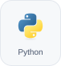
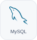
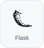
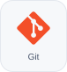

  AI Engineering Intern at <b>OriLoan Financial Inc.</b> 
  Python, SQL and R for data analytics, machine learning and automation.

  &nbsp;
  &nbsp;
  

**Tools I work with**

  
  
  
  
  
  
  
  

Tableau · Power BI · Advanced Excel · n8n · REST APIs · CI/CD · AWS CloudWatch

